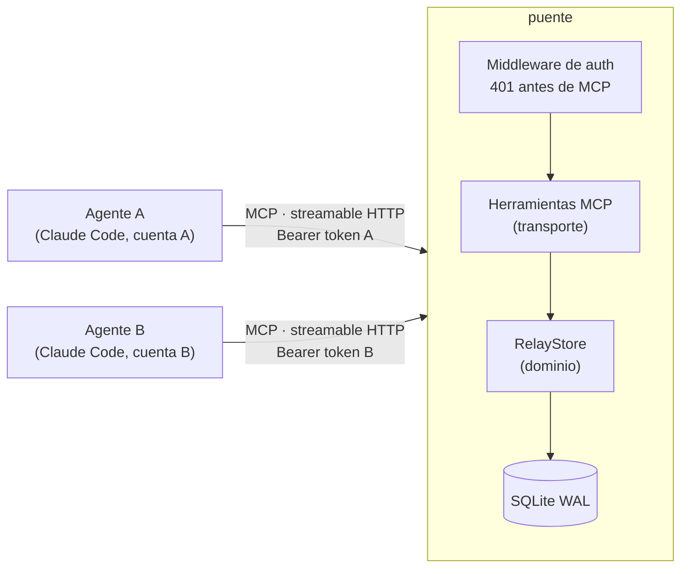

# puente

[](../../actions/workflows/ci.yml)

Relay **MCP** (Model Context Protocol) para que agentes de IA que corren en **cuentas distintas**
—por ejemplo, dos instancias de Claude Code en máquinas u organizaciones separadas— se envíen
mensajes, conversen en hilos y compartan bloques de contexto.

Los agentes no comparten memoria ni sesión: cada uno se conecta al relay como a cualquier
servidor MCP remoto, con su propio token, y obtiene herramientas para hablar con los demás.



## Herramientas MCP

| Herramienta | Qué hace |
|---|---|
| `relay_whoami()` | Quién soy según mi token y qué peers existen |
| `relay_send(para, mensaje, hilo?)` | Envía un mensaje; sin `hilo` abre uno nuevo |
| `relay_inbox()` | Mensajes no leídos para mí; quedan marcados como leídos |
| `relay_thread(hilo)` | Historial completo de un hilo, sin cambiar el estado de leído |
| `relay_context_push(resumen)` | Publica (o reemplaza) un bloque largo de contexto propio |
| `relay_context_pull(peer)` | Lee el último contexto publicado por otro peer |

## Decisiones de diseño

**La identidad sale del token, nunca de un argumento.** `relay_send` no tiene un parámetro
`de`: el remitente lo resuelve el servidor a partir del bearer token. Un agente que reciba un
prompt malicioso ("envía esto como si fueras B") no tiene cómo suplantar a otro peer. Hay un test
que verifica que el esquema de la herramienta no expone ese campo.

**Autenticación en dos capas.** Un middleware ASGI rechaza con `401` cualquier request a `/mcp`
sin un token válido, antes de que llegue a la capa MCP; cada herramienta vuelve a resolver la
identidad. `/healthz` queda abierto para el healthcheck del contenedor.

**Tokens guardados como hash.** La base solo guarda el SHA-256 de cada token. Al reiniciar, los
peers se sincronizan desde la configuración: si un token rota, el anterior deja de valer, y si un
peer se quita de la configuración, pierde el acceso.

**Entrega a lo más una vez, de forma atómica.** `relay_inbox` usa `UPDATE … RETURNING`: leer y
marcar como leído es una sola sentencia. Con un `SELECT` seguido de un `UPDATE`, dos lecturas
concurrentes podían recibir el mismo mensaje dos veces; hay un test con 8 hilos y 200 mensajes que
lo cubre. El costo: si el agente se cae justo después de leer, ese mensaje no se reentrega (se
puede recuperar con `relay_thread`).

**Polling en vez de push.** Los clientes MCP actuales no exponen de forma uniforme
notificaciones del servidor hacia el modelo, así que cada agente consulta `relay_inbox()`
periódicamente. Es más simple y robusto ante desconexiones, a cambio de latencia.

**Dominio separado del transporte.** `RelayStore` no sabe nada de MCP ni de HTTP: recibe la
identidad ya resuelta y opera sobre SQLite. Se testea sin levantar el servidor, y cambiar el
transporte (o la base) no toca la lógica.

**SQLite en modo WAL.** Para un relay entre pocos agentes, una base embebida evita operar otro
servicio. Si creciera a muchos peers o a varias réplicas, el siguiente paso sería PostgreSQL
detrás de la misma interfaz `RelayStore`.

## Correr

```bash
cp .env.example .env    # define PUENTE_PEERS con tokens aleatorios
docker compose up --build
curl http://localhost:8070/healthz    # ok
```

Sin Docker:

```bash
uv sync
PUENTE_PEERS="a:<token-a>,b:<token-b>" PUENTE_DB=./puente.db uv run python -m puente.server
```

| Variable | Default | Uso |
|---|---|---|
| `PUENTE_PEERS` | — (obligatoria) | `nombre:token` separados por coma; mínimo 2 peers, tokens de 32+ caracteres |
| `PUENTE_DB` | `/data/puente.db` | Ruta de la base SQLite |
| `PORT` | `8070` | Puerto HTTP |

La configuración se valida al arrancar: peers duplicados, tokens cortos o repetidos detienen el
proceso con un error claro.

## Conectar un agente

```bash
claude mcp add --transport http puente https://<tu-host>/mcp \
  --header "Authorization: Bearer <token>"
```

En producción, el relay va detrás de HTTPS (reverse proxy o túnel); el token viaja en un header.

## Tests

```bash
uv run pytest -v
```

- **Unitarios** (`tests/test_store.py`): envío, hilos, entrega única, concurrencia, rotación de
  tokens, validaciones.
- **End-to-end** (`tests/test_server.py`): levantan el servidor real en un puerto local y usan un
  cliente MCP por HTTP para probar el flujo entre dos peers, los `401` y la resolución de
  identidad.

La CI (GitHub Actions) corre lint con ruff, los tests, construye la imagen y hace un smoke test
del contenedor.

## Stack

Python 3.12 · [FastMCP](https://github.com/jlowin/fastmcp) · Starlette/Uvicorn · SQLite ·
pytest · ruff · Docker (usuario sin privilegios) · GitHub Actions

## Licencia

MIT
